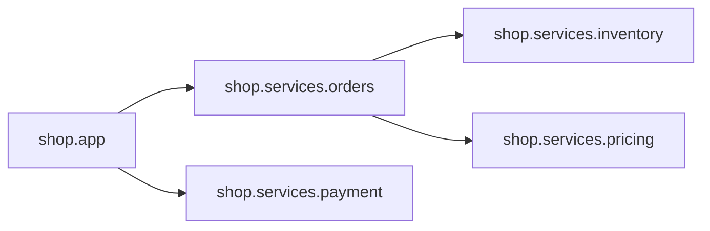

# CodeLens Project Map

7 modules / 9 functions / 5 findings

## 1. Where to start reading (entry points)

- `shop.app` (./shop/app.py) — has a `__main__` entry

## 2. Modules and dependencies

| Module | Lines | Imports | Imported by | Description |
|---|---|---|---|---|
| shop | 2 | 0 | 0 | (no docstring, please add one) |
| shop.app | 10 | 2 | 0 | Shop entry point: CLI demo for ordering and payment. |
| shop.services | 2 | 0 | 0 | (no docstring, please add one) |
| shop.services.inventory | 14 | 0 | 1 | Stock checks. |
| shop.services.orders | 16 | 2 | 1 | Order service: create orders and compute totals. |
| shop.services.payment | 9 | 0 | 1 | (no docstring, please add one) |
| shop.services.pricing | 12 | 0 | 1 | Pricing and discount rules. |

## 3. Hotspots (read these first)

| Function | Location | Complexity | Lines | Callers |
|---|---|---|---|---|
| shop.services.orders.create_order | ./shop/services/orders.py:4 | 7 | 12 | 1 |
| shop.services.pricing.apply_discount | ./shop/services/pricing.py:3 | 4 | 6 | 1 |
| shop.services.inventory.check_stock | ./shop/services/inventory.py:3 | 2 | 5 | 1 |
| shop.services.payment.charge | ./shop/services/payment.py:1 | 2 | 5 | 1 |
| shop.services.inventory.calc_total | ./shop/services/inventory.py:12 | 2 | 2 | 0 |
| shop.services.pricing.calc_total | ./shop/services/pricing.py:10 | 2 | 2 | 0 |
| shop.services.payment.refund_check | ./shop/services/payment.py:7 | 1 | 2 | 1 |
| shop.app.main | ./shop/app.py:4 | 1 | 3 | 0 |
| shop.services.inventory.reserve | ./shop/services/inventory.py:9 | 1 | 2 | 0 |

## 4. Findings (common AI-code smells)

- `shop.services.inventory:6` swallowed exception (an `except` that does nothing hides bugs)
- `shop.services.inventory:9` empty stub function reserve() (scaffolding with no implementation)
- `shop.services.orders:11` leftover marker: # TODO: handle out-of-stock properly
- `shop.services.payment:2` leftover marker: # placeholder: integrate real gateway
- `shop.services.payment:7` empty stub function refund_check() (scaffolding with no implementation)

### Same-named functions (possible duplicate implementations)

- `calc_total`: shop.services.inventory.calc_total, shop.services.pricing.calc_total