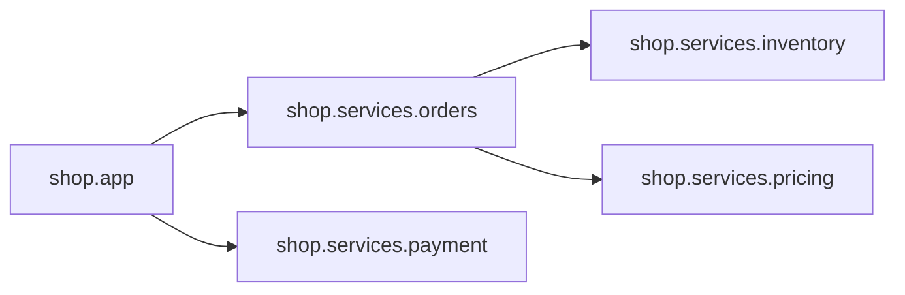

# CodeLens 项目地图

模块 7 个 / 函数 9 个 / 疑点 5 处

## 1. 从哪里读起(入口)

- `shop.app` (./shop/app.py) — 含 `__main__` 入口

## 2. 模块职责与依赖

| 模块 | 行数 | 依赖 | 被依赖 | 说明 |
|---|---|---|---|---|
| shop | 1 | 0 | 0 | (无文档,需补) |
| shop.app | 10 | 2 | 0 | Shop 入口: 下单与支付的命令行演示。 |
| shop.services | 1 | 0 | 0 | (无文档,需补) |
| shop.services.inventory | 14 | 0 | 1 | 库存检查。 |
| shop.services.orders | 16 | 2 | 1 | 订单服务: 创建订单并计算金额。 |
| shop.services.payment | 9 | 0 | 1 | (无文档,需补) |
| shop.services.pricing | 12 | 0 | 1 | 价格与折扣规则。 |

## 3. 高风险热点(先看这些)

| 函数 | 位置 | 复杂度 | 行数 | 被调用 |
|---|---|---|---|---|
| shop.services.orders.create_order | ./shop/services/orders.py:4 | 7 | 12 | 1 |
| shop.services.pricing.apply_discount | ./shop/services/pricing.py:3 | 4 | 6 | 1 |
| shop.services.inventory.check_stock | ./shop/services/inventory.py:3 | 2 | 5 | 1 |
| shop.services.payment.charge | ./shop/services/payment.py:1 | 2 | 5 | 1 |
| shop.services.inventory.calc_total | ./shop/services/inventory.py:12 | 2 | 2 | 0 |
| shop.services.pricing.calc_total | ./shop/services/pricing.py:10 | 2 | 2 | 0 |
| shop.services.payment.refund_check | ./shop/services/payment.py:7 | 1 | 2 | 1 |
| shop.app.main | ./shop/app.py:4 | 1 | 3 | 0 |
| shop.services.inventory.reserve | ./shop/services/inventory.py:9 | 1 | 2 | 0 |

## 4. 疑点清单(AI常见坑)

- `shop.services.inventory:6` 吞掉异常(except 后什么都不做),bug会被隐藏
- `shop.services.inventory:9` 空实现函数 reserve()(AI常见的'搭了架子没写内容')
- `shop.services.orders:11` 遗留标记: # TODO: handle out-of-stock properly
- `shop.services.payment:2` 遗留标记: # placeholder: integrate real gateway
- `shop.services.payment:7` 空实现函数 refund_check()(AI常见的'搭了架子没写内容')

### 同名函数(可能是AI重复实现了同一功能)

- `calc_total`: shop.services.inventory.calc_total, shop.services.pricing.calc_total